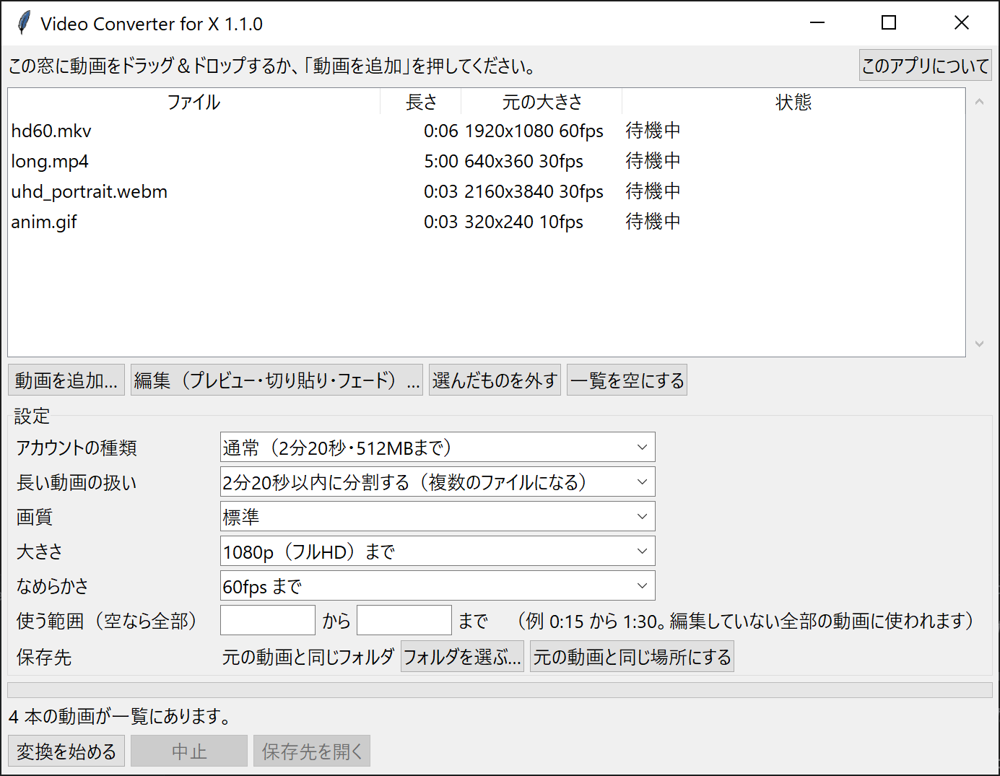
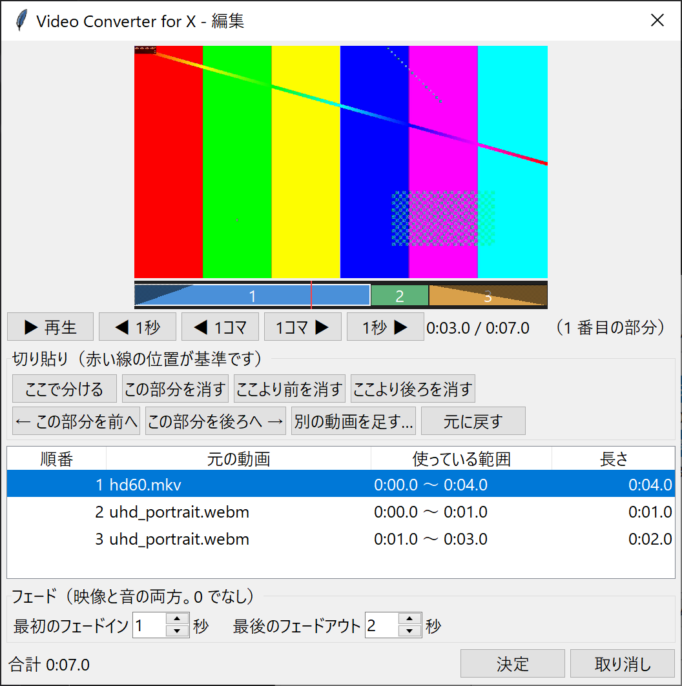

# Video Converter for X

いろいろな形式の動画を、X（旧 Twitter）の動画の投稿条件に合わせた形式（MP4・H.264・AAC）に変換する Windows 用アプリです。
プレビューを見ながらの切り貼り・つなぎ・フェードイン／フェードアウトもできます。

作者: BW　／　ライセンス: MIT（同梱ソフトはそれぞれのライセンス。下の「ライセンス」を参照）

> **非公式のツールです。** X Corp. とは関係がなく、X Corp. の承認・提携を受けたものではありません。
> 「X」「Twitter」は X Corp. の商標です。名前の「for X」は、どのサービス向けの変換かを示すためだけに使っています。




---

## できること

- mp4 / mov / mkv / avi / webm / wmv / mpg / ts / gif など、ほとんどの動画を変換できます
- 大きさ・コマ数・長さ・容量を、X の投稿条件（下の「X の投稿条件について」）に収まるように自動で調整します
- 通常アカウントの長さの上限（2分20秒）を超える動画は、分割する／最初だけ使う、を選べます
- iPhone などで撮った HDR の動画を普通の色（SDR）に直します
- プレビューを見ながら、切り貼り・複数の動画のつなぎ・最初のフェードイン／最後のフェードアウト

## 必要なもの

- Windows 10 / 11（64bit）のパソコン

## ダウンロードと起動

1. 配布ページから `VideoConverterForX-x.x.x.zip` をダウンロードします。
2. zip を右クリック →「すべて展開」で、好きな場所に展開します（zip の中から直接起動しないでください）。
3. 展開したフォルダの中の `VideoConverterForX.exe` をダブルクリックします。インストールは不要です。

> **「Windows によって PC が保護されました」と出たとき**
> 個人が作ったアプリには、この表示がよく出ます（有料の電子署名をしていないため）。
> 「**詳細情報**」をクリック →「**実行**」を押すと起動できます。
>
> ウイルス対策ソフトが誤って警告することもまれにあります。その場合は、配布ページからダウンロードしたものであることを確認したうえで、
> 除外設定をしてください。心配な場合はソースコードから自分でビルドすることもできます（下の「自分でビルドする」）。

## 使い方

1. 窓に動画をドラッグ＆ドロップするか、「動画を追加…」で選びます（複数・フォルダごとも可）。
2. 必要なら設定を変えて「変換を始める」を押します。
3. 元の動画と同じフォルダ（または選んだ保存先）に `元の名前_x.mp4` ができます。これを X に投稿します。
   分割したときは `元の名前_x_01.mp4`、`_02.mp4` … になります。

元の動画は変更しません。同じ名前の変換済みファイルが既にあるときは上書きします。

## 編集（プレビュー・切り貼り・フェード）

一覧で動画を選んで「編集…」を押す（またはダブルクリックする）と、編集の窓が開きます。
複数の動画を選んでから押すと、つなげて1本の動画にできます。

- **プレビュー**: 色の付いた帯（タイムライン）をクリック・ドラッグすると、その位置の画面が出ます。
  「▶ 再生」（スペースキー）で音付きで再生、「1コマ」「1秒」ボタン（左右キー）で少しずつ動かせます。
- **切り貼り**（赤い線の位置が基準）:
  - 「ここで分ける」… 赤い線の位置で2つの部分に分ける
  - 「この部分を消す」… 赤い線がある部分を消す（真ん中を抜くときは、前後で分けてから消す）
  - 「ここより前を消す」「ここより後ろを消す」… 最初や最後のいらない所を落とす
  - 「この部分を前へ／後ろへ」… 順番を入れ替える
  - 「別の動画を足す…」… ほかの動画を最後につなげる
  - 「元に戻す」… 1つ前の状態に戻す
- **フェード**: 最初のフェードイン・最後のフェードアウトの秒数（0〜10秒）。映像と音の両方にかかります。
- 「決定」で一覧に戻り、名前の前に ✂ が付きます。「変換を始める」で `元の名前_edit_x.mp4` ができます。
  もう一度「編集…」を押せば続きから直せます。

プレビューは軽くするために小さく・粗く（1秒15コマ）表示しています。変換した動画は元の画質・なめらかさのままです。
大きさの違う動画をつなげたときは、最初の動画の大きさに合わせ、合わない部分には黒い余白が付きます。
1回の再生は5分までです（続きは止まった所からもう一度再生）。編集の内容はアプリを閉じると消えます。

## 設定

| 項目 | 内容 |
|---|---|
| アカウントの種類 | **通常**: 2分20秒・512MB まで。**Premium**: 長い動画をそのまま1本に変換（約4時間・16GB まで） |
| 長い動画の扱い | 通常アカウントで 2分20秒を超えるとき: **分割**（2分19秒ごとに複数のファイル）／**最初だけ**／**そのまま**（投稿できない長さのまま変換。注意が表示されます） |
| 画質 | 高画質／標準／軽い。X 側で再圧縮されるので、普通は「標準」で十分です |
| 大きさ | 1080p まで／720p まで。元がそれより小さければそのまま（拡大はしません） |
| なめらかさ | 60fps まで／30fps まで。元がそれより少なければそのまま |
| 使う範囲 | 「0:15 から 1:30 まで」のように一部だけ取り出せます。空なら全部。編集していない全部の動画に使われます（編集した動画は編集の内容が優先） |
| 保存先 | 元の動画と同じフォルダ、または選んだフォルダ |

設定は次に起動したときも覚えています（`%APPDATA%\VideoConverterForX\settings.json`）。

## 自動でやること

- 大きさを 1920x1200（縦長は 1200x1920）以内に縮小。縦横比はそのまま。
- 縦横比が 3:1 より細長い動画には黒い余白を足す。
- 60fps を超える動画は 60fps に。コマ数がばらばらの動画（可変フレームレート）は一定に。
- HDR の動画は普通の色（SDR）に直す。そのまま投稿すると色が薄く見えることがあるため。
- スマホで縦に撮った動画の向き、横長の画素（DVD など）、インターレースを直す。
- 音のない動画・GIF には無音の音声を入れる。
- 容量が上限を超えそうなときは自動で画質を下げて収める。

## X の投稿条件について

このアプリは、作成時点（2026年11月）に作者が調べた次の条件に合わせて変換します。
**X の条件は予告なく変わることがあり、公式の最新の条件と照らし合わせて確認したものではありません。**
条件に合わせて変換しても、X 側の事情で投稿や再生ができない場合があります。

| 項目 | 通常アカウント | Premium |
|---|---|---|
| 長さ | 140秒（2分20秒） | 約4時間 |
| 容量 | 512MB | 16GB |
| 大きさ | 1920x1200 以内（縦長は 1200x1920 以内） | 同じ |
| 縦横比 | 1:3 〜 3:1 | 同じ |
| コマ数 | 60fps 以内 | 同じ |
| 形式 | MP4（H.264 High・yuv420p・AAC-LC） | 同じ |

## 動作確認の範囲

- 1.0.0 で変換した動画を、作者が実際に X に投稿できることを確認しています（Windows 10 で変換）。
- 1.1.0 で追加した編集機能は、自動テスト（操作・変換結果・プレビューと出力の明るさの一致など）で確認しています。
  編集した動画の投稿は、形式が 1.0.0 と同じため通る見込みですが、作者はまだ確認していません。
- HDR → SDR の変換は、処理が通ることだけを確認しています。色合いは元の動画によって違って見えることがあります。
- 4K・HDR などの重い動画では、パソコンの性能によってプレビューのコマが飛ぶことがあります（変換結果には影響しません）。
- 投稿の確認は限られた本数・環境でのものです。すべての動画・投稿方法（PC のブラウザー／スマホのアプリ）で通ることを確かめたわけではありません。Windows 11 での動作は確認していません。

## うまくいかないとき

- **「動画として読めませんでした」**: 壊れているか、コピー防止のかかった動画です。このアプリでは変換できません。
- **X で投稿に失敗する**: X の投稿条件は変わることがあります。「720p まで」「30fps まで」にして試してください。
  スマホのアプリは PC のブラウザーより条件が厳しいことがあります。
- **プレビューで音が出ない**: Windows の音の出力先（スピーカー／イヤホン）を確認してください。
- 変換は CPU で行うので、長い動画・大きい動画は時間がかかります。

## 注意

- **非公式のツールです。** X Corp. とは関係ありません。「X」「Twitter」は X Corp. の商標です。
- 変換・投稿してよいのは、**ご自身が権利を持っている動画、または権利者から使用を認められている動画だけ**です。
  他人の作品（映画・アニメ・テレビ番組・音楽など）を無断で投稿すると、著作権の侵害になることがあります。
- 投稿するときは、X の利用規約とルールを守ってください。このアプリは投稿の可否を判断するものではありません。
- コピー防止（DRM）のかかった動画を変換する機能はありません。
- このアプリは無保証です（MIT ライセンス）。大切な動画は、念のため元のファイルを残しておいてください（このアプリは元のファイルを変更しません）。

## ライセンス

- アプリ本体: MIT ライセンス（`LICENSE`）、Copyright (c) 2026 BW
- Windows 版に同梱している FFmpeg（`_internal/ffmpeg.exe`）は **GNU GPL v3** です。そのほか Python、Tcl/Tk、tkinterdnd2、PyInstaller を含みます。
  詳しくは `THIRD_PARTY_NOTICES.md` と `licenses` フォルダを見てください。FFmpeg のソースコードの入手先も `THIRD_PARTY_NOTICES.md` に書いています。

## 自分でビルドする（開発者向け）

```
pip install -r requirements.txt
python tests/run_tests.py      # テスト用の動画を tests/work に作って変換を確かめる（数分）
python build_exe.py            # exe と zip を作る（dist/、files/）
cd src && python -m xvideo.cli 入力.mp4      # コマンドライン版
```

ほかのテスト: `tests/gui_test.py`（画面の自動操作）、`tests/edit_test.py`（切り貼り・フェード）、`tests/editor_test.py`（編集の窓の自動操作。数秒音が鳴ります）。
仕組みの説明は `docs/TECHNICAL.md` を見てください。

## 更新履歴

- 1.1.0（2026年11月）… 名前を「Twitter Video Converter」から「Video Converter for X」に変更（変換したファイルの名前も `_twitter.mp4` から `_x.mp4` に）。編集機能を追加（プレビュー・音付きの再生・切り貼り・動画のつなぎ・最初のフェードイン／最後のフェードアウト）
- 1.0.0（2026年11月）… 最初の版
